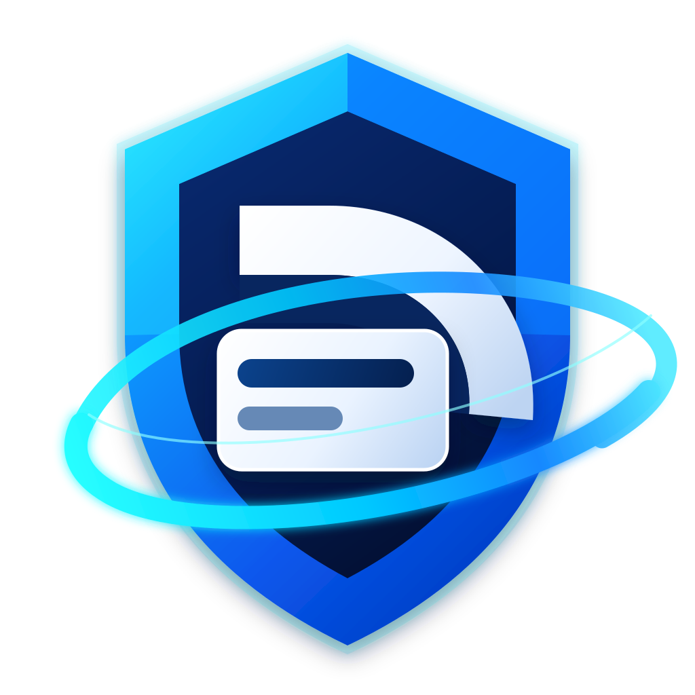
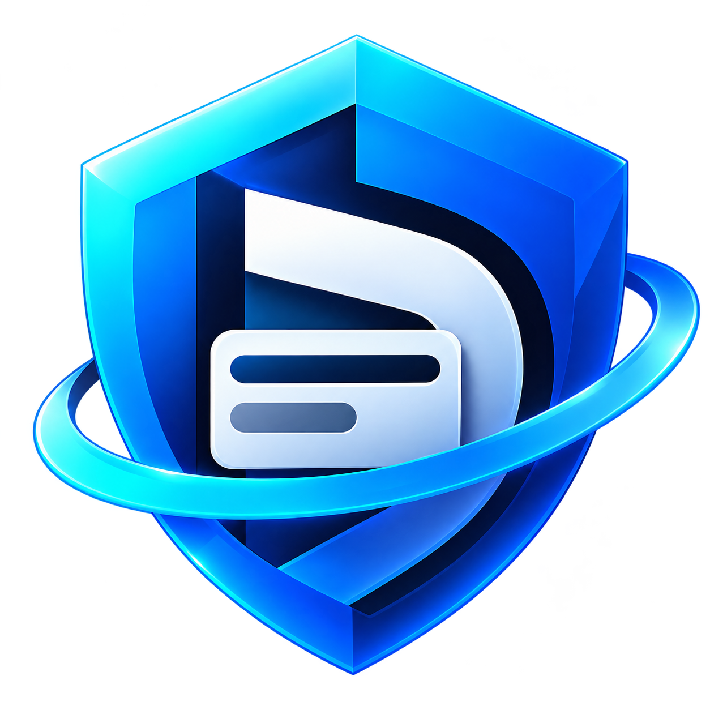

# ADGDisputeGuard

<p align="center">
  
</p>


-6f42c1)


> **Secure. Explainable. Auditable. Scalable.**

<p align="center">
  
</p>

ADGDisputeGuard is a card-dispute management platform built from a documented
specification. Alongside the landing page it now ships a **tested reference
engine** (Rust) that implements the specification's equations and flows, a
**working application** (Next.js API routes + a `/console` UI) backed by a
TypeScript port of that engine, and a **bounded AI investigation** backed by a
local Ollama model with application-enforced guardrails. A docker-compose stack
runs the app and Ollama together.

Everything remains demonstration data with an in-memory store — it does not
move real money — but the dispute flows (ownership, idempotent creation,
authorised transitions, evidence validation, audit trail, advisory risk, and a
bounded investigation) are implemented and tested end to end.

## Brand graphics

| Asset                                                     | Preview                        | Intended use                                 |
| --------------------------------------------------------- | ------------------------------ | -------------------------------------------- |
| [DisputeGuard logo (SVG)](graphics/disputeguard-logo.svg) | Vector shield logo shown above | README, documentation, and scalable displays |
| [Application icon (PNG)](graphics/applogo.png)            | App icon shown above           | Application and square icon placements       |

## Project dashboard

| Area                 | Current status                                                        |
| -------------------- | --------------------------------------------------------------------- |
| Reference engine     | Rust crate implementing the spec — 50 unit tests, LaTeX report 50/50  |
| Application          | Next.js API + `/console` UI over a TypeScript domain core — 25 tests  |
| AI investigation     | Bounded loop backed by local Ollama, guardrails enforced in app code  |
| Infrastructure       | `docker-compose` with the web app + Ollama                            |
| Authentication       | Header-based demo identity; real auth remains planned                 |
| PDF documentation    | Buildable locally with Docker                                         |

## Documentation

| Document                            | What it covers                                                 | Source                                                    | PDF                                                                   |
| ----------------------------------- | -------------------------------------------------------------- | --------------------------------------------------------- | --------------------------------------------------------------------- |
| Engineering specification           | Architecture, domain model, security, operations, and testing  | [`spec.tex`](planning/Software%20Spec/spec.tex)           | [`spec.pdf`](planning/Software%20Spec/pdf-outputs/spec.pdf)           |
| Equations and algorithms            | Plain-language explanations and implementation pseudocode      | [`equations.tex`](planning/Software%20Spec/equations.tex) | [`equations.pdf`](planning/Software%20Spec/pdf-outputs/equations.pdf) |
| Software Requirements Specification | Testable requirements, acceptance criteria, and open decisions | [`srs.tex`](planning/Software%20Spec/srs.tex)             | [`srs.pdf`](planning/Software%20Spec/pdf-outputs/srs.pdf)             |

## Run the landing page

Requires Node.js 22.13 or newer and npm. From the repository root:

```sh
npm ci
npm run dev
```

Open [localhost:3000](http://localhost:3000). For a production preview:

```sh
npm run build
npm run start
```

Use `PORT=3100 npm run start` to choose another port. `npm run typecheck`
checks the frontend's TypeScript types. Run `npm test` for the investigation
loop termination and sample transaction integrity checks.

The Next.js application lives in `apps/web`. It includes a Three.js shield,
a responsive landing page, swipeable sample payment cards, selectable
transactions connected to an interactive dispute journey, an explorable
architecture diagram, a RALPH concept visualisation, and the three project PDFs. Fonts are
served locally. Reduced-motion preferences are respected, and an SVG
fallback is shown when WebGL is unavailable.

The walkthrough is an illustrative frontend demonstration with mock data;
it does not submit disputes, authenticate users, or move money. The three
90+ figures are Lighthouse **targets**, not reported benchmark results.
The architecture diagram describes the planned system.

The card carousel supports pointer swipes, previous/next controls, direct
card selection, and left/right keyboard arrows. Each card has its own mock
transactions. Completed payments can populate the dispute walkthrough;
pending payments explain the demo restriction without submitting anything.

The landing-page RALPH visualisation demonstrates successful human handoff,
iteration-budget exhaustion, and rejection of a disallowed tool. The simulation
performs no model calls or writes. Its limits are illustrative; production
limits remain configuration decisions. The working `/console` investigation
(below) implements the same bounded pattern against a real local model.

## Reference engine (Rust)

`engine/` is a tested Rust implementation of the equations and flows in the
[equations document](planning/Software%20Spec/equations.tex): exact money,
server-side access rules, the authorised dispute lifecycle with optimistic
concurrency, idempotent and uniqueness-guarded creation, an audit log, the
evidence upload workflow, safe background retries, deterministic advisory risk
indicators, and the bounded AI investigation.

```sh
cd engine
./run-tests.sh        # cargo tests + regenerate and compile the LaTeX report
```

This runs 50 unit tests and produces [`engine/report/report.pdf`](engine/report/report.pdf),
a pass/fail report of the equations and flows (50/50 checks). Requires Rust
(`rustup`) and, for the PDF, `pdflatex`.

## Application (Next.js API + console)

`apps/web/lib/domain/` is a TypeScript port of the engine and the app's source
of truth. API route handlers under `apps/web/app/api/` expose the flows:

| Route                                  | Purpose                                             |
| -------------------------------------- | --------------------------------------------------- |
| `GET  /api/transactions`               | List transactions visible to the acting user        |
| `POST /api/disputes`                   | Open a dispute (ownership, idempotency, uniqueness)  |
| `GET  /api/disputes` / `/api/disputes/[id]` | List / inspect disputes and their audit trail   |
| `POST /api/disputes/[id]/transition`   | Role-gated, version-checked lifecycle transition     |
| `POST /api/disputes/[id]/evidence`     | Validate and record an evidence upload               |
| `POST /api/disputes/[id]/investigate`  | Run the bounded, Ollama-backed investigation         |

The acting user is taken from `x-user-id` / `x-user-role` headers in this demo
(a real deployment derives it from a verified session). Open the
**[/console](http://localhost:3000/console)** page to drive the flows: switch
roles, open disputes, advance the lifecycle, upload sample evidence, inspect the
audit trail, and run an investigation.

```sh
npm ci
npm test          # 25 node:test cases for the domain core, API handlers and investigation
npm run dev       # then open http://localhost:3000/console
```

## Run the full stack (app + Ollama)

```sh
cd infra
OLLAMA_MODEL=llama3.2 docker compose up --build
```

See [`infra/README.md`](infra/README.md) for details. The bounded investigation
enforces the allowlist, read-only tool execution, and iteration/tool-call budget
in application code — never trusted from the model — and falls back to a
deterministic proposer when Ollama is unreachable.

## Ralph loop

Phase 2 of this project was executed as a [Ralph loop](planning/RALPH/RALPH_LOOP.md):
each backlog item is implemented with tests, verified, logged in
[`RALPH_LOG.md`](planning/RALPH/RALPH_LOG.md) with its commit, and pushed. The
loop's plan and progress live in `planning/RALPH/`.

Document copies served by the website live in `apps/web/public/documents`.
Refresh those copies when the source PDFs in `planning/Software Spec/pdf-outputs`
change. The website's logo is copied from `graphics/disputeguard-logo.svg`.

## Build the documentation

With Docker installed and running, build the three PDFs and collect them in
`planning/Software Spec/pdf-outputs/`:

```sh
./scripts/build-and-collect-pdfs.sh
```

To build a single document without collecting the other PDFs:

```sh
./scripts/build-spec-pdf.sh
./scripts/build-equations-pdf.sh
./scripts/build-srs-pdf.sh
```

Individual scripts write build files to `build/`. The combined script builds
all three documents and moves the resulting PDFs to the output folder.
